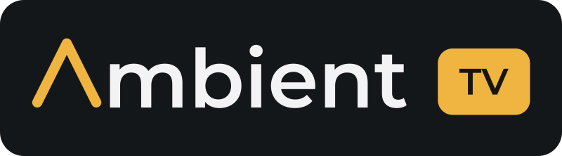
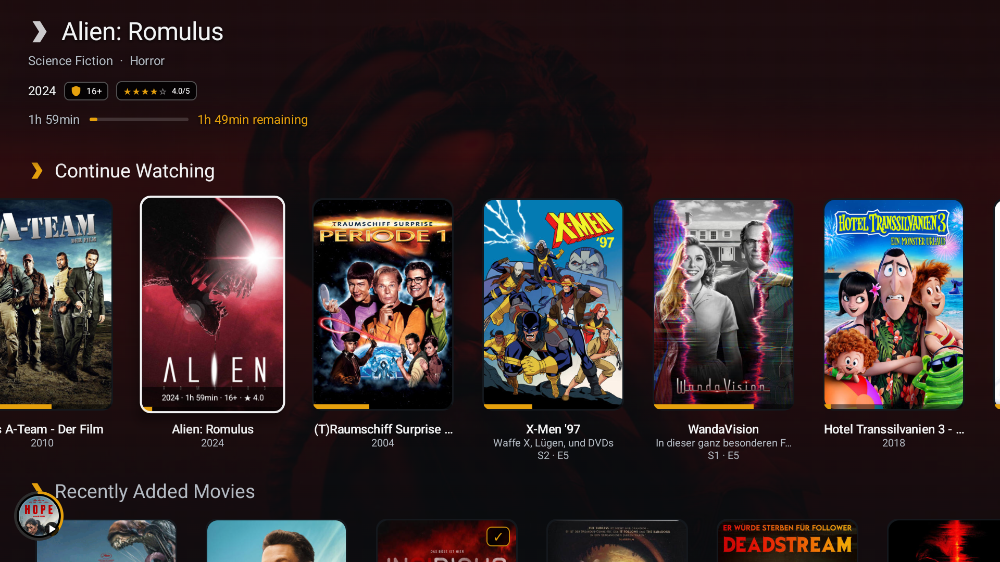
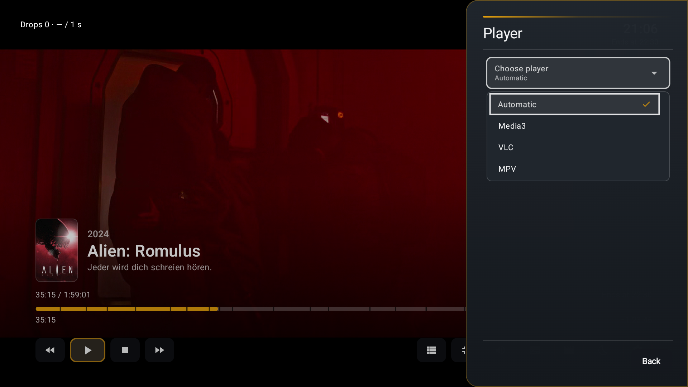
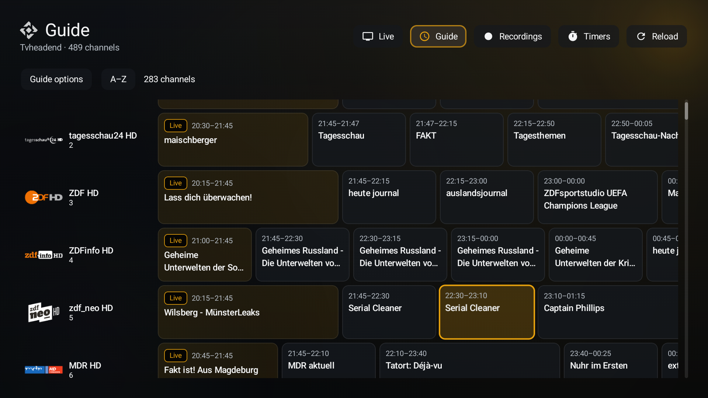

<div align="center">



**Android-TV- und Handy-Client für lokale Medien – Plex, Jellyfin, Emby, TVHeadend, SmartTube, Radio, DLNA, Dateien/NAS und Fotos in einer App, abgespielt mit MPV, VLC oder Media3, dazu Retro-Spiele über libretro aus eigenen Ordnern oder von einem RomM-Server. Optional mit Monogram (Telegram-Medien).**

[](#voraussetzungen)
[](#funktionen)
[](https://kotlinlang.org)
[](https://developer.android.com/compose)

<!-- version-badge:start -->

[](#)

<!-- version-badge:end -->

[](https://github.com/sponsors/seinist)
[](https://ko-fi.com/seinist)
[](LICENSE)

[Screenshots](#screenshots) · [Funktionen](#funktionen) · [Warum?](#warum) · [Unterstützen](#unterstützen) · [Haftungsausschluss](#haftungsausschluss) · [Bauen](#bauen) · [Doku](#dokumentation) · [English](README.md)

</div>

## Screenshots

<table>
<tr>
<td width="33%" valign="top"><a href="docs/screenshots/01-home.png"></a><br><b>Startseite</b></td>
<td width="33%" valign="top"><a href="docs/screenshots/04-player-engine-selection.png"></a><br><b>Player-Auswahl</b></td>
<td width="33%" valign="top"><a href="docs/screenshots/07-tv-programme-guide.png"></a><br><b>TV-Programmführer</b></td>
</tr>
</table>

[Alle Screenshots auf der Website](https://seinist.github.io/ambient-tv/?lang=de#screens)

<p align="center">

**Package** `com.ambient.tv` · **Version (Repo)** <!-- version:start -->`1.0` (451)<!-- version:end --> · **Min. Android** API 29 · **Lizenz** [CC0 1.0](LICENSE)

</p>

## Warum?

Angefangen hat alles mit Plex. Jedem Client fehlte etwas – etwa Wake-on-LAN für den Server oder eine echte Bildbearbeitung mit Scalern, Upscalern und Filtern, wie sie bisher kein anderer Player auf Android TV bietet. Hier ist all das drin.

Daraus wurde eine All-in-one-Lösung: Jedes Video, egal aus welcher Quelle, läuft durch den Renderer meiner Wahl. WireGuard ist eingebaut, damit die Mediatheken auch unterwegs nur einen Klick entfernt sind. Und die guten Ideen, die sonst über ein halbes Dutzend Player verstreut sind, finden endlich in einer App zusammen.

## Unterstützen

Ambient TV entsteht in der Freizeit, aus Liebe zu einem guten Fernsehabend. Wenn es deinen Fernseher ein bisschen schöner macht, hilft ein Kaffee oder ein Sponsoring, dass es weitergeht – danke! ☕

[](https://ko-fi.com/seinist) [](https://github.com/sponsors/seinist)

## Haftungsausschluss

> [!WARNING]
> Ambient TV ist ein Hobbyprojekt und wird so bereitgestellt, wie es ist. **Nutzung auf eigene Gefahr.** Für geschmolzene Fernseher, explodierte TV-Boxen, überhitzte Wohnzimmer oder plötzliche Lust auf neue Hardware wird keine Haftung übernommen.
>
> Bildverarbeitung ist hungrig: Wie gut Filter, Upscaler/Shader, Zwischenbildberechnung (SVP), Deinterlacing, HDR-Umwandlung und Co. laufen, hängt **stark von deiner Hardware** ab. Was auf der einen Box butterweich läuft, macht die andere zur Diashow (und zum Heizlüfter). Ruckelt es, die Einstellungen zurückdrehen oder den Leistungsmodus auf „Sparsam“ stellen.

## Funktionen

<table>
<tr>
<td width="50%" valign="top">

### 📚 Quellen
- **Plex · Jellyfin · Emby** – Mediatheken, Home-Reihen, Suche, Titelmusik
- **TVHeadend** – Live-TV, EPG, Aufnahmen, Timer; Aufnahmen und Timer bearbeiten (Vor-/Nachlauf, Priorität) und löschen, Bilder aus EPG, TMDb oder Senderlogo
- **IPTV** – M3U-Wiedergabelisten mit XMLTV-Programmführer
- **SmartTube** – YouTube-Feeds, **SponsorBlock**, Anmeldung per QR-Code
- **Radio (Radio Browser)** – Internetradio nach Genre, Land und Sprache; Favoriten, Verlauf und globale Suche, ohne Benutzerkonto
- **Monogram (Telegram)** – Kanalmedien, vollständige Beitragstexte, Vorschaubilder und YouTube-Links, sechs konfigurierbare Home-Reihen (inklusive Fotos), QR-/Telefon-/2FA-Anmeldung; Media3/VLC/MPV (GPL-3.0-only)
- **Trailer** (TMDB) · **DLNA-Server** · **Fotos**
- **Dateien** – Lokal/USB, **SMB 1/2/3**, **NFSv3/v4**, **WebDAV** (HTTP/HTTPS), **SFTP** (Passwort oder SSH-Schlüssel)
- **Musik in Dateien/NAS** — Titel-Tags, Albumreihenfolge und Cover aus dem Ordner

</td>
<td width="50%" valign="top">

### ▶️ Wiedergabe
- **Media3, VLC und MPV** in einem gemeinsamen Player
- **Live-TV-Timeshift** — Pause, Spulen und zurück zu Live; EPG-Erinnerungen und optionale TVHeadend-Direktaufnahme
- **Videotext** (auch Untertitel) und experimentelles **HbbTV / Rote Taste**, soweit vom Sender unterstützt
- **Untertitel** — externe Dateien bei Dateien/NAS und DLNA, Online-Suche über OpenSubtitles.com (eigener API-Schlüssel), **automatisch synchronisieren** am Server-Untertitel, eigenes **Aussehen** für Text-Untertitel (ASS/SSA behalten ihren Stil)
- **Player-Werkzeuge** — A-B-Wiederholung, Einzelbild, **Lesezeichen**, Bildschirmfotos
- **Musik** — **lückenlose** Wiedergabe (Media3), **Songtexte** (Plex, Jellyfin, optional LRCLIB)
- **Miniplayer** & Hintergrundwiedergabe; Zurück führt zum laufenden Player zurück
- **Als Nächstes** mit optionaler minimalistischer Karte; Schwellen für **gesehen und Fortsetzen** wie bei Kodi
- Bildeinstellungen **pro Titel gemerkt**
- **Anzeigemodus-Anpassung**, optional **SDR → HDR10** (Android 14+)
- **Deinterlacing** – BWDIF, YADIF, NNEDI, IVTC, …
- **Zwischenbildberechnung (SVP)**, experimentell

</td>
</tr>
<tr>
<td valign="top">

### 🎨 Bild
- MPV-**Scaler** + GPU-Shader-**Upscaler**: NNEDI3, RAVU, FSRCNNX, ArtCNN, Anime4K, NVIDIA NIS, AMD FSR
- **Debanding, Schärfen, Entrauschen**, HDR-Tone-Mapping
- **Media3-GPU-Filter** – MPVs Kernel (EWA Lanczos, Robidoux, Splines, …), RAVU, NVIDIA NIS, FSR, CAS/Adaptive Sharpen, Debanding, Entrauschen, Filmkorn, auf 4K-Panels in 4K gerendert
- Bildoptionen für **VLC**
- **Acht Accent-Stile**, dezente Animationen bei maximaler Oberflächenleistung und separate TV-Oberflächenauflösung (System, 1080p oder Display-Auflösung)
- **Optionale View-Übergänge**: Aus (Standard), Soft Fade, Fade + Micro-Slide oder cinematische Ein-Layer-Überblendung. Die Auswahl wird per Backup/TV-Sync mitgenommen; Sparsam schaltet Effekte ab.

</td>
<td valign="top">

### 🔊 Ton
- **Audioprofile** je Ausgang (TV / HDMI-AVR / Kopfhörer)
- **Passthrough** – AC3, E-AC3, DTS, DTS-HD, TrueHD
- **Upmix, Nachtmodus, Dialoganhebung**, Lautstärkeausgleich, 10-Band-EQ
- **Nachtmodus nach Uhrzeit** — jeder Player schaltet ihn im Zeitfenster ein
- Visualizer / **projectM**

</td>
</tr>
<tr>
<td valign="top">

### 🌐 Netzwerk
- **Wake-on-LAN** für Server, NAS-Quellen und DLNA-Server, nach Rechner gruppiert
- Eingebautes **WireGuard**, je System schaltbar
- Kompakter **Verbindungsstatus** für VPN, Wake-on-LAN und Serververbindungen, mit Abbrechen/Wiederholen je Gerät und aufklappbaren technischen Details auf TV und Handy
- Start-Intros enden innerhalb von **fünf Sekunden**; laufende Verbindungen werden in der App weiter angezeigt, ohne jeden erledigten Schritt erneut einzublenden
- **DLNA-Renderer** – Empfang von BubbleUPnP, VLC, …

</td>
<td valign="top">

### 📱 Geräte & Extras
- **TV- (D-Pad/Sidebar)** und **Handy-Oberfläche (Touch)** in einer APK
- **Android Auto (Audio)** – Radio, IPTV-/TVHeadend-Radiosender, Musik aus Plex/Jellyfin/Emby, DLNA und lokalen/NAS-Dateien
- **Android-TV-System- und Sprachsuche** findet Titel aus Plex, Jellyfin und Emby
- **Offline-Server** bleiben mit dezentem Status und gespeicherten Inhalten im Menü; Erneut versuchen verbindet neu und weckt nur einen Rechner, der wirklich aus ist, Offline-Server werden nicht ständig abgefragt
- **Handy ↔ TV koppeln** – Fernbedienung, Wiedergabe senden, Konten übertragen
- **Uhr** in den Kopfzeilen, auf der Startseite und im Player (Format, Datum, Aussehen)
- **Wetter** mit gespeicherten Orten, Stunden-/Tagesvorhersage sowie auswählbaren Radar- und Satellitenkarten; wahlweise in Menü, Kopfzeile und Bildschirmschoner
- **Lichtstimmungen** über der Startseite, **Filterleiste** über Mediatheken, Programmführer, Trailern und YouTube
- **Leistungsmodus** Auto / Ausgewogen / Sparsam, Bildschirmschoner, Startbildschirm-Kanäle
- **Log-Viewer** auf TV und Handy (Suche, Filter, ZIP-Export)
- **Einstellungs-Backup** (Schema 84; API-Daten nur im passwortverschlüsselten Export mit Zugangsdaten) · DE/EN UI

</td>
</tr>
<tr>
<td valign="top">

### 🎮 Spiele
- **libretro-Spiele-Player** für 31 Konsolen – von NES bis PlayStation 2, GameCube/Wii/Wii U, DS/3DS, PSP, Dreamcast, Saturn und die Commodore-Familie; Cores werden bei Bedarf geladen (eigene signierte Builds oder libretro-Buildserver), mehrere je System, vorheriger Core wiederherstellbar
- **Spielebibliothek** aus lokalen, USB- und NAS-Ordnern: eigenes Spiele-Menü, Konsolen, Favoriten, Zuletzt gespielt, A–Z und Home-Reihen; Metadaten und Cover (Libretro, optional ScreenScraper/TheGamesDB)
- **RomM** als eigenes System – Bibliothek, Firmware, Speicherstände, Spielstände, Memory Cards und Favoriten verwaltet der Server, Anmeldung per Code, offline aus der letzten Kopie spielbar
- **Spielstände wie Kapitel**, Zurückspulen, Vorspulen, Cheats, RetroAchievements, LAN-Spiel mit einem zweiten Ambient TV
- **Bild** – Filter (Skalierung, Röhre, Handheld, analoges Signal), optionale signierte Shader-Pakete, ganzzahlige Skalierung, Vulkan für GPU-Cores, SDR-Spiele als HDR10
- Große Disc-Abbilder werden **direkt vom NAS** gelesen, ohne Kopie

</td>
<td valign="top">

### 🕹️ Steuerung
- **Menü-, Wiedergabe- und Spielsteuerung** – eigene Aktionen je Taste, kurz oder gehalten, für Fernbedienung, Tastatur und Controller, gewählt am Bild des Geräts
- **Spielecontroller** bedienen die ganze App; Modelle von Xbox, PlayStation und Nintendo werden erkannt
- **Spielbelegungen** je Konsole, Emulator und Spiel, jede Konsole mit eigenem Controller-Bild; alle Tasten nacheinander zuweisen
- **Touch-Steuerung** am Handy und das gekoppelte **Handy als Gamepad** für den TV

</td>
</tr>
</table>

**Spotify-Hinweis:** Spotify ist in regulären Builds derzeit **deaktiviert**. Spotify stellt dem verwendeten librespot-Wiedergabekern keine funktionierenden Audioschlüssel mehr bereit; daher funktioniert die Spotify-Wiedergabe aktuell nicht. Die nicht funktionsfähige Integration wird nicht als verfügbare Quelle angezeigt.

📖 Jede Einstellung und Player-Option: **[Funktionskompendium](docs/DOCUMENTATION.de.md)** · [English](docs/DOCUMENTATION.md) · [Docs-Index](docs/README.md)

## Voraussetzungen

| Voraussetzung | Details |
| --- | --- |
| **Geräte** | Android TV / Google TV, Handys und Tablets mit **Android API 29+** |
| **ABIs** | arm64-v8a · armeabi-v7a · x86 · x86_64 |
| **Geräteabhängig** | Vulkan-Ausgabe/-Dekodierung, SDR → HDR (Android 14+, HDR10-Display), Passthrough-Formate, SVP, Vulkan für GPU-Spiele-Cores |
| **Netzwerk** | LAN zu Medienserver/NAS/RomM; Internet für Plex-Link, SmartTube, Trailer, optional Monogram und zum Laden von Spiele-Cores |
| **Build** | **JDK 17**, Android SDK/NDK (`ANDROID_NDK_HOME` oder `ANDROID_NDK_ROOT`); optional Keystore |

## Bauen

<details>
<summary><b>Bauen & starten</b></summary>

```bash
# Debug-APK (baut Native-Engines bei Bedarf mit)
./build.sh debug

# Signiertes Release (wenn keystore.properties vorhanden)
./build.sh release

# Privater Build: Account-Schlüssel aus private-keys.env (git-ignoriert,
# Vorlage private-keys.env.example) einbauen; die Eingaben in den Einstellungen entfallen.
# Schlüssel in einer APK sind auslesbar: solche Builds nie veröffentlichen.
PRIVATE_KEYS=1 ./build.sh release

# Einzelne ABI (ARM TV / Geräte)
./build.sh arm64
./build.sh armv7

# Emulator-ABIs
./build.sh x86
./build.sh x86_64

# Gradle-Maven-Abhängigkeiten prüfen / aktualisieren (stabile Releases)
./build.sh deps-check
./build.sh deps-update
./build.sh deps-update media3  # optional nur Media3
# Externe Engines prüfen / Pins aktualisieren
./build.sh libs-check
./build.sh libs-update
./build.sh cores-check
./build.sh cores-update
```

Artefakte landen unter `dist/` (z. B. `ambient-tv-arm64-<version>.apk`, `ambient-tv-x86_64-<version>.apk`). Vorab-Suffixe wie `beta`, `alpha` oder `rc` bleiben am Ende, die Build-Nummer steht davor (`ambient-tv-arm64-1.0.270-beta.apk`).

Gradle direkt (mit automatischer MPV/FFmpeg-Vorbereitung bei fehlenden Local-Audio-Headern oder -Bibliotheken): `./gradlew :app:assembleDebug` – für produktnahe Builds `./build.sh` bevorzugen. `SKIP_MPV_NATIVE=1` überspringt den nativen MPV-Build (schnelle Builds/CI), z. B. `SKIP_MPV_NATIVE=1 ./gradlew :app:assembleDebug :app:testDebugUnitTest`.

Details und Umgebungsvariablen: [docs/DOCUMENTATION.de.md §14](docs/DOCUMENTATION.de.md#14-entwicklung-und-build) · [EXTERNAL_LIBRARIES.md](EXTERNAL_LIBRARIES.md)

</details>

<details>
<summary><b>Release-Signierung</b></summary>

Der Release-Keystore und `keystore.properties` liegen nicht im Repository (beide stehen in `.gitignore`). Zum Signieren entweder eine lokale `keystore.properties` (`storeFile`, `storePassword`, `keyAlias`, `keyPassword`) neben `build.sh` ablegen oder setzen:

```bash
export AMBIENT_TV_KEYSTORE_FILE=/pfad/zu/release.jks
export AMBIENT_TV_KEYSTORE_PASSWORD=…
export AMBIENT_TV_KEY_ALIAS=…
export AMBIENT_TV_KEY_PASSWORD=…
```

Ohne beides funktionieren Debug-Builds, Release-APKs bleiben unsigniert. `./build.sh gen-keystore` erzeugt einen neuen Schlüssel.

</details>

<details>
<summary><b>Einstellungen (Kurz)</b></summary>

| Bereich | Inhalt |
| --- | --- |
| Start & Bedienung | Home-Reihen, Medienauswahl, Sprache, Bibliothek |
| Darstellung | Theme, Akzent, Skalierung, **Leistung**, Hintergrundvideo, Bildschirmschoner |
| Systeme & Konten | Plex / Jellyfin / Emby / TVH / IPTV / SmartTube / Radio / Monogram / Trailer / DLNA / RomM / Dateien |
| Geräte & Netzwerk | Handy & Geräte, UPnP-Receiver, WireGuard / VPN, Server & Wake-on-LAN |
| Wiedergabe | Player-Backend, Untertitel, „Als Nächstes“, Spulen & Fortsetzen, Spiele (Cores, BIOS, Spieleordner, Shader-Pakete) |
| Bild & Ton | Bild-/Audioprofile, Visualizer, Fotos |
| App & Daten | Backup, Diagnose, Menü-/Wiedergabe-/Spielsteuerung, Erweitert, Über |


</details>

### Monogram einrichten (optionale Telegram-Medien)

> **Inoffizieller Client, nutzt die Telegram-API.** Monogram in Ambient TV ist keine App von Telegram.

**Lizenz:** Die Monogram-Integration steht unter **GPL-3.0-only**. Sein vollständiger Quellcode ist dieses Repository plus das festgelegte Upstream-Monogram-Release in `gradle/external-versions.properties` (`MONOGRAM_VERSION`, derzeit Release 0.5.0, mit geprüftem Tag-Commit `MONOGRAM_REF` und mono-rs-Submodul-Commit `MONOGRAM_MONO_RS_REF`), mit den Änderungen aus `scripts/patch_monogram_leave.py`; jede von diesem Skript geänderte Upstream-Datei trägt einen datierten Änderungshinweis.

<details>
<summary>Eigene Telegram-API-ID und API-Hash hinterlegen und per TV-QR-Code oder Telefoncode anmelden</summary>

**Verfügbarkeit:** Monogram ist in regulären Release-APKs enthalten und lässt sich mit eigenen Telegram-API-Zugangsdaten aktivieren. Entwickler-/Debug-Builds können es auslassen; Details stehen in der [technischen Integrations- und Build-Doku](docs/monogram-integration.md). GPL-Lizenzpflichten und Telegram-API-Bedingungen gelten weiterhin; die Renderer benötigen geräteabhängige Tests.

1. Mit deinem **Telegram-Konto** unter [my.telegram.org/apps](https://my.telegram.org/apps) anmelden und eine Telegram-API-Anwendung erstellen. **API-ID** (Zahl) und **API-Hash** (32 Hex-Zeichen) kopieren.
2. In der Ambient-TV-Release-APK **Einstellungen › Medienquellen & Konten › Monogram** öffnen. Die API-Felder sind auch bei noch deaktiviertem System verfügbar.
3. **API-ID** und **API-Hash** eintragen und **API-Zugangsdaten speichern** wählen. Der Hash wird verdeckt eingegeben; die Werte landen verschlüsselt auf dem Gerät, **nicht** fest in der APK.
4. **Monogram aktivieren**. Im Kontoabschnitt erscheint der Anmeldestatus mit den passenden Wegen:
   - **Android TV:** **Mit QR-Code anmelden** wählen. Telegram auf einem **bereits angemeldeten Handy** öffnen, unter **Einstellungen › Geräte** den QR-Code scannen und die Anmeldung bestätigen. Dies ist ein Telegram-`tg://`-Anmeldetoken.
   - **Handy oder Alternative am TV:** Telefonnummer mit Ländervorwahl eintragen, **Anmeldecode senden** wählen und den von Telegram erhaltenen Code bestätigen. Bei Bedarf das Passwort für die **Zwei-Schritt-Verifizierung** eingeben. Am Handy wird der QR-Login nicht angezeigt, da es den eigenen Bildschirm nicht scannen kann.
5. Sobald **Verbundenes Konto** erscheint, die sechs Monogram-Tabs bzw. Home-Reihen einrichten: **Neue Medien, Kanäle, Videos, YouTube-Links, Musik und Audio, Fotos**. YouTube-Videos öffnen sich über die vorhandene SmartTube-Auswahl; vollständige Telegram-Beitragstexte stehen auf der Detailseite.

**Backup:** Das normale Einstellungsbackup sichert Monogram, Menü/TV-Chips und Home-Reihen. **Export mit Zugangsdaten** enthält außerdem API-ID und API-Hash in einer passwortverschlüsselten Sicherung, **nicht** aber die Telegram-Anmeldung oder privat heruntergeladene Medien. Nach einem Gerätewechsel ist eine erneute Anmeldung erforderlich. Zum Ändern der API-Zugangsdaten zuvor abmelden.

</details>

### Releases

Ein `v*`-Tag baut die signierten Release- und Debug-APKs und veröffentlicht ein GitHub-Release – Einrichtung, Secrets und Versionierung: [Build-Doku §14.5](docs/DOCUMENTATION.de.md#145-releases-und-versionierung).


## Ausprobieren & mitgestalten

Ambient TV entsteht aus Leidenschaft – für alle, die mehr aus ihrem Mediensetup holen wollen. **Probier es aus**, kitzle das Letzte aus den Filtern heraus (mit Gefühl – siehe Haftungsausschluss) und sag mir, wie es dir gefällt: Fehler, Abstürze, Ideen und „Wäre schön, wenn …“ sind in den [Issues](../../issues) jederzeit willkommen. Jede Rückmeldung hilft, Ambient TV zum besten Medien-Client auf Android TV zu machen.

## Bekannte Grenzen

- Die NNEDI-Deinterlace-Gewichte (`app/src/main/res/raw/nnedi3_deinterlace_weights.bin`, GPL-2.0-or-later) bleiben im Baum; andere native Bibliotheken (MPV/FFmpeg, …) baut oder lädt `./build.sh` beim ersten Mal.
- Keine Garantie für jede Codec-/Filter-Kombination auf jedem Gerät; Bildfilter brauchen eine GPU-Videoausgabe
- Dateien: kein NFS-Kerberos, kein NFSv4.1+, keine NetBIOS-Suche, kein FTP; WebDAV mit Basic- oder Digest-Anmeldung
- DLNA-Renderer: kein Google Cast, keine DRM-Inhalte, keine Bilder
- Spiele: Die Cores für PlayStation 2, Wii U und Ymir (Saturn) sind experimentell; neuere Cores brauchen noch Tests auf weiteren Geräten. GameCube, Wii, Wii U, 3DS und PlayStation 2 brauchen ein 64-Bit-Gerät, 32-Bit-TVs (armeabi-v7a) spielen also 26 der 31 Systeme. Die Cores für DS, 3DS, GameCube, Wii, Wii U, PSP, PlayStation 2, Dreamcast, Saturn, Atari 5200/7800 und die Commodore-Rechner kommen vom libretro-Buildserver, nicht aus dem signierten eigenen Build. ROMs, BIOS-Dateien und Spieledatenbanken sind nicht enthalten

## Dokumentation

| Dokument | Sprache |
| --- | --- |
| [docs/DOCUMENTATION.md](docs/DOCUMENTATION.md) | English (Standard, vollständig) |
| [docs/DOCUMENTATION.de.md](docs/DOCUMENTATION.de.md) | Deutsch (vollständig) |
| [README.md](README.md) | English – Kurzüberblick |
| [docs/README.md](docs/README.md) | Docs-Index (EN) |
| [docs/RETRO_GAME_LIBRARY.md](docs/RETRO_GAME_LIBRARY.md) · [docs/game-player-osd.md](docs/game-player-osd.md) · [docs/game-metadata.md](docs/game-metadata.md) | EN – Spiele: Bibliothek, Spiele-Player, Metadaten |
| [EXTERNAL_LIBRARIES.md](EXTERNAL_LIBRARIES.md) | EN – Engine-Pins |

## Lizenz

Dieses Projekt steht unter **[Creative Commons Zero v1.0 Universal (CC0-1.0)](LICENSE)** – Verzicht auf Urheberrechte soweit rechtlich möglich; ohne Garantie.

Drittanbieter-Engines und Marken (Plex, Jellyfin, Emby, YouTube/SmartTube, …) unterliegen eigenen Lizenzen und Kennzeichnungen – siehe „Über“ in der App und `third_party_licenses/`.

**Gebaute APKs:** Die App enthält GPL-lizenzierte Bestandteile (mpv: GPL-2.0-or-later; FFmpeg, von mpv-android mit `--enable-gpl --enable-version3` gebaut: GPL-3.0-or-later; NNEDI-Gewichte: GPL-2.0-or-later; TVHeadend-Logo: GPL-3.0-or-later) und LGPL-Bestandteile (VLC, SVP-Adapter); der Spiele-Player nutzt LibretroDroid (GPL-3.0). libretro-Cores sind nie enthalten: Jeder Core wird auf Wunsch geladen und behält seine eigene Lizenz (manche erlauben nur nicht-kommerzielle Nutzung). Die enthaltenen GLSL-Shader stehen unter LGPL-3.0-or-later, MIT, BSD-2-Clause oder CC0-1.0 (siehe `SHADER_SOURCES_027.json`). Aus diesem Repository gebaute APKs werden daher unter den Bedingungen der **GNU GPL v3.0** verteilt; der zugehörige Quelltext ist dieses Repository plus die gepinnten Upstream-Quellen in `gradle/external-versions.properties`.

---

<div align="center"><sub>Ambient TV · gemacht für den großen Bildschirm · <a href="#warum">warum es das gibt</a></sub></div>
