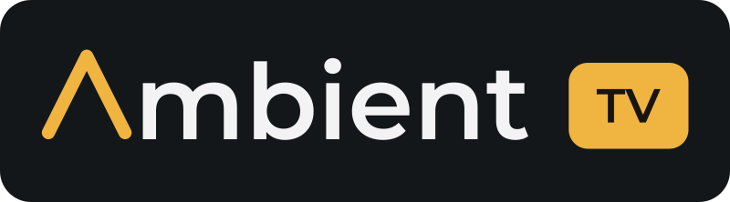
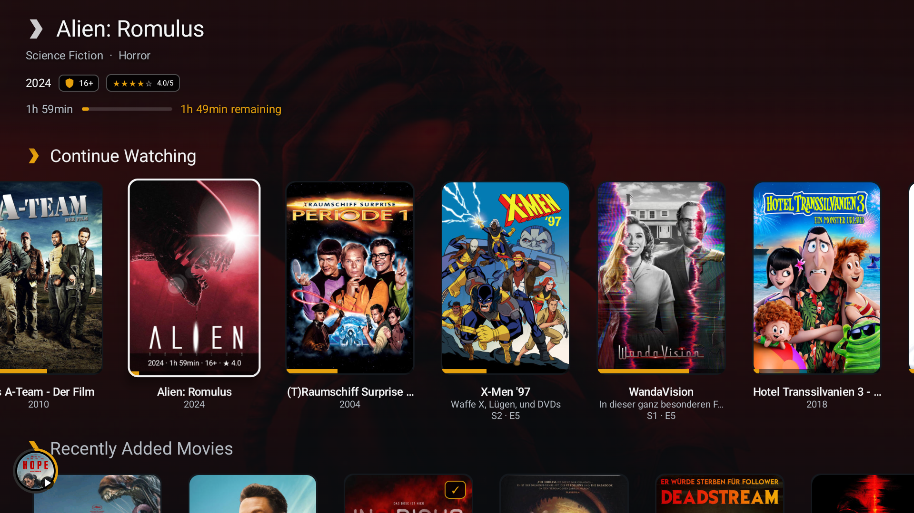
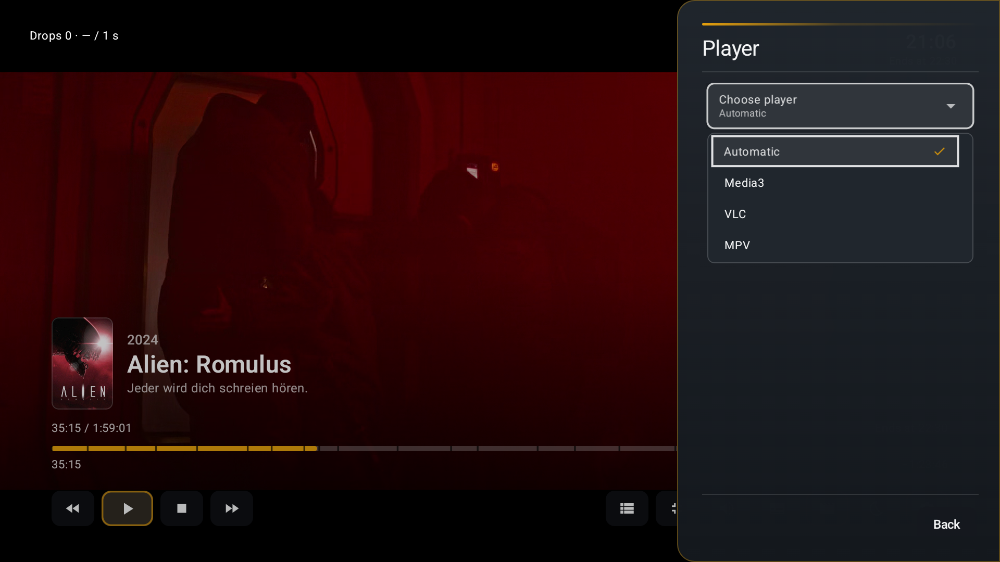
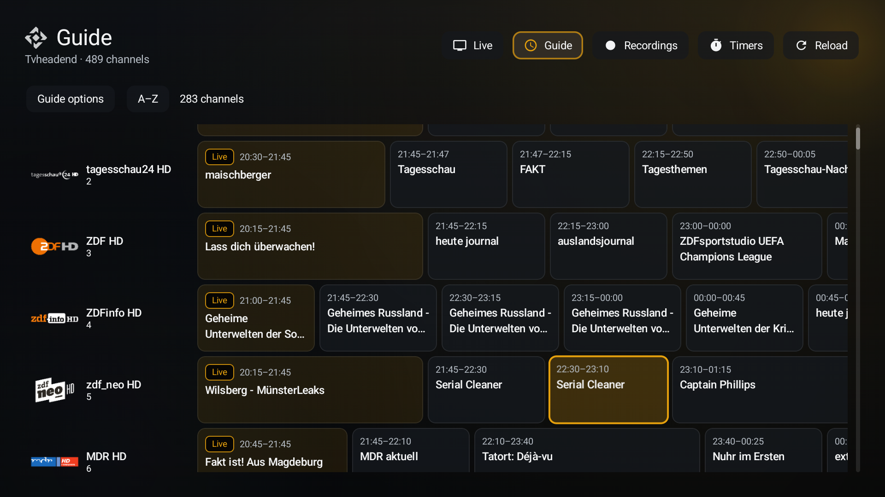

<div align="center">



**Android TV & phone client for local media — Plex, Jellyfin, Emby, TVHeadend, SmartTube, Radio, DLNA, files/NAS and photos in one app, played through MPV, VLC or Media3, plus retro games through libretro from your own folders or a RomM server. Optional Monogram (Telegram media) integration.**

[](#requirements)
[](#features)
[](https://kotlinlang.org)
[](https://developer.android.com/compose)

<!-- version-badge:start -->

[](#)

<!-- version-badge:end -->

[](https://github.com/sponsors/seinist)
[](https://ko-fi.com/seinist)
[](LICENSE)

[Screenshots](#screenshots) · [Features](#features) · [Why?](#why) · [Support](#support) · [Disclaimer](#disclaimer) · [Build](#build) · [Docs](#documentation) · [Deutsch](README.de.md)

</div>

## Screenshots

<table>
<tr>
<td width="33%" valign="top"><a href="docs/screenshots/01-home.png"></a><br><b>Home</b></td>
<td width="33%" valign="top"><a href="docs/screenshots/04-player-engine-selection.png"></a><br><b>Player selection</b></td>
<td width="33%" valign="top"><a href="docs/screenshots/07-tv-programme-guide.png"></a><br><b>TV programme guide</b></td>
</tr>
</table>

[All screenshots on the website](https://seinist.github.io/ambient-tv/?lang=en#screens)

<p align="center">

**Package** `com.ambient.tv` · **Version (repo)** <!-- version:start -->`1.0` (451)<!-- version:end --> · **Min Android** API 29 · **License** [CC0 1.0](LICENSE)

</p>

## Why?

It started with Plex. Every client out there was missing something — Wake-on-LAN for the server, say, or real picture processing with the scalers, upscalers and filters that no other Android TV player offers. So this one has them.

From there the goal grew into an all-in-one app: every video, whatever its source, runs through the renderer of my choice. WireGuard is built in, so the libraries are just as close when I'm away from home. And the good ideas that are usually scattered across half a dozen players finally live together in one place.

## Support

Ambient TV is built in spare time, out of love for a good couch evening. If it makes your TV a little nicer, a coffee or a sponsorship helps keep it going — thank you! ☕

[](https://ko-fi.com/seinist) [](https://github.com/sponsors/seinist)

## Disclaimer

> [!WARNING]
> Ambient TV is a hobby project, provided as is. **Use at your own risk.** No responsibility is taken for melting TVs, exploding TV boxes, overheated living rooms or a sudden urge to buy new hardware.
>
> Picture processing is hungry: how well filters, upscalers/shaders, motion smoothing (SVP), deinterlacing, HDR conversion and friends run depends **heavily on your hardware**. What is silky smooth on one box can turn another into a slideshow (and a space heater). If playback stutters, lower the settings or switch the performance mode to Low.

## Features

<table>
<tr>
<td width="50%" valign="top">

### 📚 Sources
- **Plex · Jellyfin · Emby** — libraries, Home rows, search, theme music
- **TVHeadend** — live TV, EPG, recordings, timers; edit (padding, priority) and delete recordings and timers, artwork from the guide, TMDb or the channel logo
- **IPTV** – M3U playlists with an XMLTV programme guide
- **SmartTube** — YouTube feeds, **SponsorBlock**, sign-in by QR code
- **Radio (Radio Browser)** — internet stations by genre, country and language; favorites, recent stations and global search, without a user account
- **Monogram (Telegram)** — channel media, full post text and previews, YouTube links, six configurable Home rows (including Photos), QR/phone/2FA sign-in; Media3/VLC/MPV playback (GPL-3.0-only)
- **Trailers** (TMDB) · **DLNA servers** · **Photos**
- **Files** — local/USB, **SMB 1/2/3**, **NFSv3/v4**, **WebDAV** (HTTP/HTTPS), **SFTP** (password or SSH key)
- **Music in Files/NAS** — track tags, album ordering and folder artwork

</td>
<td width="50%" valign="top">

### ▶️ Playback
- **Media3, VLC and MPV** in one shared player
- **Live TV timeshift** — pause, seek and back to live; EPG reminders and optional TVHeadend direct recording
- **Teletext** (including subtitles) and experimental **HbbTV / red button**, when supported by the channel
- **Subtitles** — sidecar files for Files/NAS and DLNA, online search via OpenSubtitles.com (own API key), **automatic sync** to the server's subtitle, your own **look** for text subtitles (ASS/SSA keep their style)
- **Player tools** — A-B repeat, frame step, **bookmarks**, screenshots
- **Music** — **gapless** playback (Media3), **lyrics** (Plex, Jellyfin, optional LRCLIB)
- **Mini-player** & background playback; Back leads back to the running player
- **Next Up** with an optional minimalist card; Kodi-style **watched and resume thresholds**
- Picture settings **remembered per title**
- **Display-mode matching**, optional **SDR → HDR10** (Android 14+)
- **Deinterlacing** — BWDIF, YADIF, NNEDI, IVTC, …
- **Motion smoothing (SVP)**, experimental

</td>
</tr>
<tr>
<td valign="top">

### 🎨 Picture
- MPV **scalers** + GPU shader **upscalers**: NNEDI3, RAVU, FSRCNNX, ArtCNN, Anime4K, NVIDIA NIS, AMD FSR
- **Debanding, sharpening, denoise**, HDR tone mapping
- **Media3 GPU filters** — MPV's kernels (EWA Lanczos, Robidoux, Splines, …), RAVU, NVIDIA NIS, FSR, CAS/Adaptive Sharpen, deband, denoise, film grain, rendered at 4K on 4K panels
- Image options for **VLC**
- **Eight accent styles**, optional subtle animations in Maximum UI performance mode and separate TV interface resolution (system, 1080p or display resolution)
- **Optional view transitions**: Off (default), Soft fade, fade + micro-slide, or cinematic single-layer blend. File backups and Companion TV sync preserve the choice; low UI performance disables effects.

</td>
<td valign="top">

### 🔊 Sound
- **Audio profiles** per output (TV / HDMI-AVR / headphones)
- **Passthrough** — AC3, E-AC3, DTS, DTS-HD, TrueHD
- **Upmix, night mode, dialogue boost**, normalization, 10-band EQ
- **Night mode by the clock** — every player switches it on in a time window
- Visualizer / **projectM**

</td>
</tr>
<tr>
<td valign="top">

### 🌐 Network
- **Wake-on-LAN** for servers, NAS sources and DLNA servers, grouped by computer
- Built-in **WireGuard**, switchable per system
- Compact **startup status** for VPN, Wake-on-LAN and server connections, with per-device cancel/retry actions and expandable diagnostics on TV and phones
- Startup intros finish within **five seconds**; pending connections continue in the app without repeating each completed step
- **DLNA renderer** — receive from BubbleUPnP, VLC, …

</td>
<td valign="top">

### 📱 Devices & extras
- **TV (D-pad / sidebar)** and **phone (touch)** UI in one APK
- **Android Auto audio browser** — Radio, IPTV/TVHeadend radio channels, Plex/Jellyfin/Emby music, DLNA and local/NAS audio
- **Android TV system and voice search** finds titles from Plex, Jellyfin and Emby
- **Offline servers** stay in the menu with a quiet status and their saved content; Retry reconnects and wakes only a machine that is really down, and offline servers are not polled
- **Phone ↔ TV pairing** — remote, send playback, transfer accounts
- **Clock** in page headers, on Home and in the player (format, date, look)
- **Weather** with saved locations, hourly/daily forecasts and manually chosen radar/satellite maps; optional menu, header and screensaver display
- **Light moods** above Home, **filter bar** above libraries, guide, trailers and YouTube
- **Performance modes** Auto / Balanced / Low, screensaver, home-screen channels
- **Log viewer** on TV and phones (search, filters, ZIP export)
- **Settings backup** (schema 84; API credentials only with encrypted, password-protected export) · DE/EN UI

</td>
</tr>
<tr>
<td valign="top">

### 🎮 Games
- **libretro game player** for 31 consoles — NES to PlayStation 2, GameCube/Wii/Wii U, DS/3DS, PSP, Dreamcast, Saturn and the Commodore family; cores load on demand (own signed builds or the libretro build server), several per system, previous core restorable
- **Game library** from local, USB and NAS folders: own Games menu, consoles, favorites, recently played, A–Z and Home rows; metadata and artwork (Libretro, optional ScreenScraper/TheGamesDB)
- **RomM** as its own system — library, firmware, saves, states, memory cards and favorites managed by the server, sign-in by code, playable offline from the last copy
- **Save states like chapters**, rewind, fast forward, cheats, RetroAchievements, LAN play with a second Ambient TV
- **Picture** — filters (scaling, CRT, handheld, analog signal), optional signed shader packs, whole-number scaling, Vulkan for GPU cores, SDR games as HDR10
- Large disc images are read **directly from the NAS**, without a copy

</td>
<td valign="top">

### 🕹️ Controls
- **Menu, playback and game controls** — own actions per key, pressed or held, for remote, keyboard and controller, chosen on a picture of the device
- **Game controllers** operate the whole app; Xbox, PlayStation and Nintendo models are recognised
- **Game layouts** per console, emulator and game, each console with its own controller picture; assign all buttons in order
- **Touch controls** on phones and the paired **phone as a gamepad** for the TV

</td>
</tr>
</table>

**Spotify status:** Spotify is currently **disabled** in regular builds. Spotify no longer supplies usable audio keys to the app's librespot-based playback backend, so playback currently does not work. The nonworking integration is hidden rather than advertised as an available source.

📖 Every setting and player option: **[feature compendium](docs/DOCUMENTATION.md)** · [Deutsch](docs/DOCUMENTATION.de.md) · [Docs index](docs/README.md)

## Requirements

| Requirement | Details |
| --- | --- |
| **Devices** | Android TV / Google TV, phones and tablets with **Android API 29+** |
| **ABIs** | arm64-v8a · armeabi-v7a · x86 · x86_64 |
| **Device-dependent** | Vulkan output/decoding, SDR → HDR (Android 14+, HDR10 display), passthrough formats, SVP, Vulkan for GPU game cores |
| **Network** | LAN to media servers / NAS / RomM; internet for Plex Link, SmartTube, trailers, opt-in Monogram and loading game cores |
| **Build** | **JDK 17**, Android SDK/NDK (`ANDROID_NDK_HOME` or `ANDROID_NDK_ROOT`); optional keystore |

## Build

<details>
<summary><b>Build & run</b></summary>

```bash
# Debug APK (builds native engines if needed)
./build.sh debug

# Signed release (when keystore.properties is present)
./build.sh release

# Private build: compile account keys from private-keys.env (git-ignored,
# template private-keys.env.example) into the APK; Settings hide those inputs.
# Keys inside an APK can be extracted: never publish such builds.
PRIVATE_KEYS=1 ./build.sh release

# Single ABI (ARM TV / devices)
./build.sh arm64
./build.sh armv7

# Emulator ABIs
./build.sh x86
./build.sh x86_64

# Check / update Gradle Maven dependencies (stable releases)
./build.sh check-deps
./build.sh update-deps
./build.sh update-deps media3  # optional single pin
# Check / update pinned external engines
./build.sh libs-check
./build.sh libs-update
```

Artifacts land under `dist/` (e.g. `ambient-tv-arm64-<version>.apk`, `ambient-tv-x86_64-<version>.apk`). Pre-release suffixes such as `beta`, `alpha` or `rc` keep the suffix and insert the build number before it (`ambient-tv-arm64-1.0.270-beta.apk`).

Gradle only (no native preflight): `./gradlew :app:assembleDebug` — prefer `./build.sh` for product-like builds. `SKIP_MPV_NATIVE=1` skips the native MPV build (quick builds/CI), e.g. `SKIP_MPV_NATIVE=1 ./gradlew :app:assembleDebug :app:testDebugUnitTest`.

Optional game metadata keys and provider setup: [docs/game-metadata.md](docs/game-metadata.md).

Details & env vars: [docs/DOCUMENTATION.md §14](docs/DOCUMENTATION.md#14-development-and-build) · [EXTERNAL_LIBRARIES.md](EXTERNAL_LIBRARIES.md)

</details>

<details>
<summary><b>Release signing</b></summary>

The release keystore and `keystore.properties` are not in the repository (both are in `.gitignore`). To sign, either keep a local `keystore.properties` (`storeFile`, `storePassword`, `keyAlias`, `keyPassword`) next to `build.sh`, or set:

```bash
export AMBIENT_TV_KEYSTORE_FILE=/path/to/release.jks
export AMBIENT_TV_KEYSTORE_PASSWORD=…
export AMBIENT_TV_KEY_ALIAS=…
export AMBIENT_TV_KEY_PASSWORD=…
```

Without either, debug builds work and release APKs stay unsigned. `./build.sh gen-keystore` creates a new key.

</details>

<details>
<summary><b>Settings map</b></summary>

| Area | Contents |
| --- | --- |
| Start & controls | Home rows, media selection, language, library |
| Appearance | Theme, accent, scale, **performance**, background video, screensaver |
| Systems & accounts | Plex / Jellyfin / Emby / TVH / IPTV / SmartTube / Radio / Monogram / Trailers / DLNA / RomM / Files |
| Devices & network | Phone & devices, UPnP receiver, WireGuard / VPN, servers & Wake-on-LAN |
| Playback | Player backend, subtitles, “Up next”, seek & resume, games (cores, BIOS, game folders, shader packs) |
| Picture & sound | Image/audio profiles, visualizer, photos |
| App & data | Backup, diagnostics, menu / playback / game controls, advanced, About |


</details>

### Monogram setup (optional Telegram media integration)

> **Unofficial client, uses the Telegram API.** Monogram in Ambient TV is not an app made by Telegram.

**License:** The Monogram integration is **GPL-3.0-only**. Its complete source is this repository plus the pinned upstream Monogram release in `gradle/external-versions.properties` (`MONOGRAM_VERSION`, currently release 0.5.0, with its reviewed tag commit `MONOGRAM_REF` and mono-rs submodule commit `MONOGRAM_MONO_RS_REF`), with the changes from `scripts/patch_monogram_leave.py`; every upstream file that script changes carries a dated modification notice.

<details>
<summary>Use your own Telegram API ID and hash, then sign in by TV QR or phone code</summary>

**Availability:** Monogram is included in regular release APKs and can be enabled with your own Telegram API credentials. Developer/debug builds may omit it; see the [technical integration and build notes](docs/monogram-integration.md). GPL licensing and Telegram API terms apply; compatibility of all playback engines still needs device-specific testing.

1. Sign in at [my.telegram.org/apps](https://my.telegram.org/apps) using **your own Telegram account** and create a Telegram API application. Copy its **API ID** (a number) and **API hash** (32 hexadecimal characters).
2. In an Ambient TV release APK, open **Settings › Media sources & accounts › Monogram**. The credentials section is available even before turning the system on.
3. Enter the **API ID** and **API hash**, then choose **Save API credentials**. The hash is masked and both values are stored in encrypted app preferences, *not embedded in the APK*.
4. Enable **Monogram**. The account section will show your connection status and sign-in methods:
   - **Android TV:** Choose **Sign in with QR code**, then use Telegram on an **already signed-in phone** to scan and approve the QR from **Settings › Devices** in Telegram. This is a Telegram `tg://` login token.
   - **Phone or TV alternative:** Enter the Telegram phone number including the country code, choose **Send login code**, enter the code delivered by Telegram, and confirm a **two-step verification password** if requested. On a phone, the QR method is omitted because it cannot scan its own screen.
5. Once the **Connected account** status appears, configure the six available Monogram tabs/Home rows: **Recent media, Channels, Videos, YouTube links, Music & audio, Photos**. The YouTube tab opens videos via the existing SmartTube selection behavior; full Telegram captions are shown on post detail pages.

**Backups:** Regular backups include Monogram settings, menu/TV chips and Home rows. **Export with credentials** additionally includes the API ID/hash inside a passphrase-encrypted backup; Telegram authorization and downloaded private media **never** travel in backups. Sign in again after restoring on another device. Changing your API credentials requires signing out first.

</details>

### Releases

A `v*` tag push builds the signed release and debug APKs and publishes a GitHub Release — setup, secrets and versioning: [build docs §14.5](docs/DOCUMENTATION.md#145-releases-and-versioning).


## Try it & help shape it

Ambient TV is built by one enthusiast for everyone who wants more from their media setup. **Give it a spin**, push the filters to the limit (gently — see the disclaimer) and tell me what you think: bugs, crashes, ideas and "it would be great if…" are all welcome in the [issues](../../issues). Every report helps make Ambient TV the best media client on Android TV.

## Known limits

- NNEDI deinterlace weights (`app/src/main/res/raw/nnedi3_deinterlace_weights.bin`, GPL-2.0-or-later) are kept in-tree; other native libraries (MPV/FFmpeg, …) are built or downloaded by `./build.sh` on first use.
- No guarantee for every codec/filter combination on every device; image filters need a GPU video output
- Files: no NFS Kerberos, NFSv4.1+ or NetBIOS discovery, no FTP; WebDAV with Basic or Digest auth
- DLNA renderer: no Google Cast, DRM content or images
- Games: the PlayStation 2, Wii U and Ymir (Saturn) cores are experimental; newer cores still need testing on more devices. GameCube, Wii, Wii U, 3DS and PlayStation 2 need a 64-bit device, so 32-bit TVs (armeabi-v7a) play 26 of the 31 systems. Cores for DS, 3DS, GameCube, Wii, Wii U, PSP, PlayStation 2, Dreamcast, Saturn, Atari 5200/7800 and the Commodore machines come from the libretro build server, not from the signed own build. No ROMs, BIOS files or game databases are included

## Documentation

| Document | Language |
| --- | --- |
| [docs/DOCUMENTATION.md](docs/DOCUMENTATION.md) | English (default, full) |
| [docs/DOCUMENTATION.de.md](docs/DOCUMENTATION.de.md) | Deutsch (vollständig) |
| [README.de.md](README.de.md) | Deutsch – Kurzüberblick |
| [docs/README.md](docs/README.md) | Docs index (EN) |
| [docs/RETRO_GAME_LIBRARY.md](docs/RETRO_GAME_LIBRARY.md) · [docs/game-player-osd.md](docs/game-player-osd.md) · [docs/game-metadata.md](docs/game-metadata.md) | EN – games: library, game player, metadata |
| [EXTERNAL_LIBRARIES.md](EXTERNAL_LIBRARIES.md) | EN – engine pins |

## License

This project is dedicated to the public domain under **[Creative Commons Zero v1.0 Universal (CC0-1.0)](LICENSE)** — to the extent possible under law; no warranty.

Third-party engines and trademarks (Plex, Jellyfin, Emby, YouTube/SmartTube, …) remain under their own licenses and branding — see About in the app and `third_party_licenses/`.

**Built APKs:** the app bundles GPL-licensed components (mpv: GPL-2.0-or-later; FFmpeg, built by mpv-android with `--enable-gpl --enable-version3`: GPL-3.0-or-later; NNEDI weights: GPL-2.0-or-later; TVHeadend logo: GPL-3.0-or-later) and LGPL components (VLC, SVP adapters); the game player uses LibretroDroid (GPL-3.0). libretro cores are never bundled: each core is downloaded on request and keeps its own license (some allow non-commercial use only). The bundled GLSL shaders are LGPL-3.0-or-later, MIT, BSD-2-Clause or CC0-1.0 (see `SHADER_SOURCES_027.json`). APKs built from this repository are therefore distributed under the terms of the **GNU GPL v3.0**; the corresponding source is this repository plus the pinned upstream sources in `gradle/external-versions.properties`.

---

<div align="center"><sub>Ambient TV · made for the big screen · <a href="#why">why it exists</a></sub></div>
