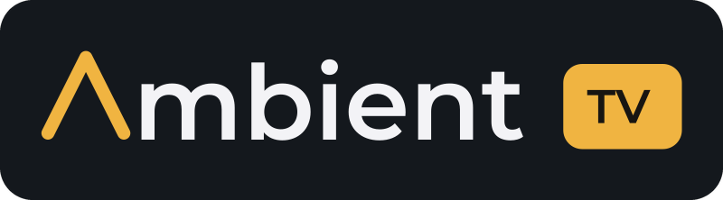
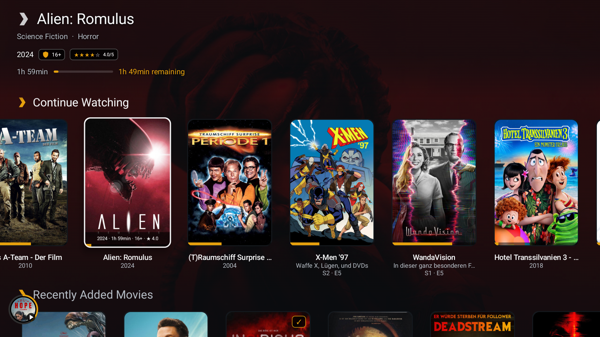
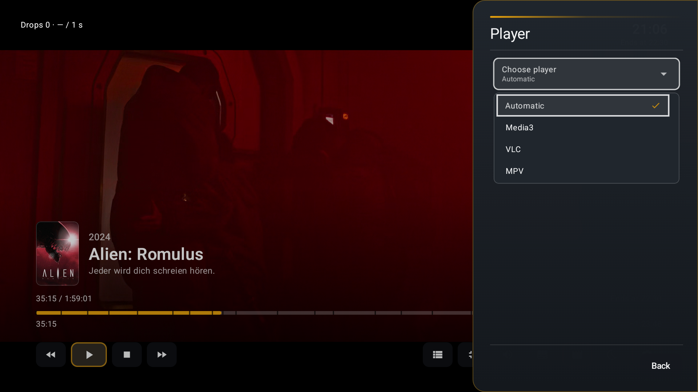
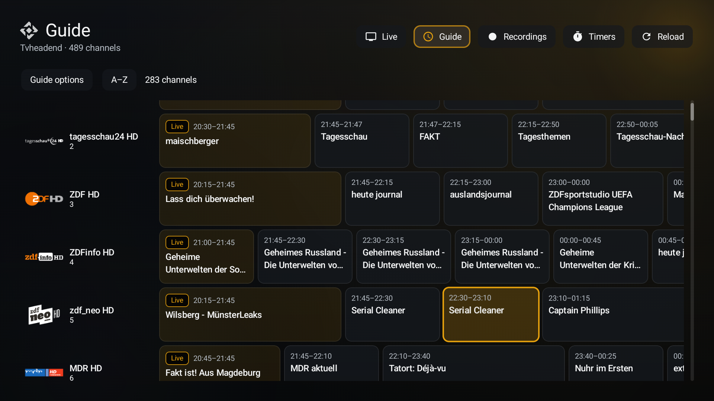

<div align="center">



**Android TV & phone client for local media — Plex, Jellyfin, Emby, TVHeadend, SmartTube, Spotify, DLNA, files/NAS and photos in one app, played through MPV, VLC or Media3.**

[](#requirements)
[](#features)
[](https://kotlinlang.org)
[](https://developer.android.com/compose)

<!-- version-badge:start -->

[](#)

<!-- version-badge:end -->

[](https://github.com/sponsors/seinist)
[](https://ko-fi.com/seinist)
[](LICENSE)

[Screenshots](#screenshots) · [Features](#features) · [Why?](#why) · [Support](#support) · [Disclaimer](#disclaimer) · [Build](#build) · [Docs](#documentation) · [Deutsch](README.de.md)

</div>

## Screenshots

<table>
<tr>
<td width="33%" valign="top"><a href="docs/screenshots/01-home.png"></a><br><b>Home</b></td>
<td width="33%" valign="top"><a href="docs/screenshots/04-player-engine-selection.png"></a><br><b>Player selection</b></td>
<td width="33%" valign="top"><a href="docs/screenshots/07-tv-programme-guide.png"></a><br><b>TV programme guide</b></td>
</tr>
</table>

[All screenshots on the website](https://seinist.github.io/ambient-tv/?lang=en#screens)

<p align="center">

**Package** `com.ambient.tv` · **Version (repo)** <!-- version:start -->`1.0` (352)<!-- version:end --> · **Min Android** API 29 · **License** [CC0 1.0](LICENSE)

</p>

## Why?

It started with Plex. Every client out there was missing something — Wake-on-LAN for the server, say, or real picture processing with the scalers, upscalers and filters that no other Android TV player offers. So this one has them.

From there the goal grew into an all-in-one app: every video, whatever its source, runs through the renderer of my choice. WireGuard is built in, so the libraries are just as close when I'm away from home. And the good ideas that are usually scattered across half a dozen players finally live together in one place.

## Support

Ambient TV is built in spare time, out of love for a good couch evening. If it makes your TV a little nicer, a coffee or a sponsorship helps keep it going — thank you! ☕

[](https://ko-fi.com/seinist) [](https://github.com/sponsors/seinist)

## Disclaimer

> [!WARNING]
> Ambient TV is a hobby project, provided as is. **Use at your own risk.** No responsibility is taken for melting TVs, exploding TV boxes, overheated living rooms or a sudden urge to buy new hardware.
>
> Picture processing is hungry: how well filters, upscalers/shaders, motion smoothing (SVP), deinterlacing, HDR conversion and friends run depends **heavily on your hardware**. What is silky smooth on one box can turn another into a slideshow (and a space heater). If playback stutters, lower the settings or switch the performance mode to Low.

## Features

<table>
<tr>
<td width="50%" valign="top">

### 📚 Sources
- **Plex · Jellyfin · Emby** — libraries, Home rows, search, theme music
- **TVHeadend** — live TV, EPG, recordings, timers; edit (padding, priority) and delete recordings and timers, artwork from the guide, TMDb or the channel logo
- **IPTV** – M3U playlists with an XMLTV programme guide
- **SmartTube** — YouTube feeds, **SponsorBlock**, sign-in by QR code
- **Spotify** — Connect receiver + native playback (librespot)
- **Trailers** (TMDB) · **DLNA servers** · **Photos**
- **Files** — local/USB, **SMB 1/2/3**, **NFSv3/v4**, **WebDAV** (HTTP/HTTPS), **SFTP** (password or SSH key)
- **Music in Files/NAS** — track tags, album ordering and folder artwork

</td>
<td width="50%" valign="top">

### ▶️ Playback
- **Media3, VLC and MPV** in one shared player
- **Live TV timeshift** — pause, seek and back to live; EPG reminders and optional TVHeadend direct recording
- **Subtitles** — sidecar files for Files/NAS and DLNA, online search via OpenSubtitles.com (own API key), **automatic sync** to the server's subtitle, your own **look** for text subtitles (ASS/SSA keep their style)
- **Player tools** — A-B repeat, frame step, **bookmarks**, screenshots
- **Music** — **gapless** playback (Media3), **lyrics** (Plex, Jellyfin, optional LRCLIB)
- **Mini-player** & background playback
- Picture settings **remembered per title**
- **Display-mode matching**, optional **SDR → HDR10** (Android 14+)
- **Deinterlacing** — BWDIF, YADIF, NNEDI, IVTC, …
- **Motion smoothing (SVP)**, experimental

</td>
</tr>
<tr>
<td valign="top">

### 🎨 Picture
- MPV **scalers** + GPU shader **upscalers**: NNEDI3, RAVU, FSRCNNX, ArtCNN, Anime4K, NVIDIA NIS, AMD FSR
- **Debanding, sharpening, denoise**, HDR tone mapping
- **Media3 GPU filters** — MPV's kernels (EWA Lanczos, Robidoux, Splines, …), RAVU, NVIDIA NIS, FSR, CAS/Adaptive Sharpen, deband, denoise, film grain, rendered at 4K on 4K panels
- Image options for **VLC**

</td>
<td valign="top">

### 🔊 Sound
- **Audio profiles** per output (TV / HDMI-AVR / headphones)
- **Passthrough** — AC3, E-AC3, DTS, DTS-HD, TrueHD
- **Upmix, night mode, dialogue boost**, normalization, 10-band EQ
- **Night mode by the clock** — every player switches it on in a time window
- Visualizer / **projectM**

</td>
</tr>
<tr>
<td valign="top">

### 🌐 Network
- **Wake-on-LAN** for servers, NAS sources and DLNA servers, grouped by computer
- Built-in **WireGuard**, switchable per system
- **DLNA renderer** — receive from BubbleUPnP, VLC, …

</td>
<td valign="top">

### 📱 Devices & extras
- **TV (D-pad / sidebar)** and **phone (touch)** UI in one APK
- **Android TV system and voice search** finds titles from Plex, Jellyfin and Emby
- Offline servers stay in the menu with a **wake / reconnect** page
- **Phone ↔ TV pairing** — remote, send playback, transfer accounts
- **Clock** in page headers, on Home and in the player (format, date, look)
- **Light moods** above Home, **filter bar** above libraries, guide, trailers and YouTube
- **Performance modes** Auto / Balanced / Low, screensaver, home-screen channels
- **Settings backup** (schema 72, optionally encrypted) · DE/EN UI

</td>
</tr>
</table>

📖 Every setting and player option: **[feature compendium](docs/DOCUMENTATION.md)** · [Deutsch](docs/DOCUMENTATION.de.md) · [Docs index](docs/README.md)

## Requirements

| Requirement | Details |
| --- | --- |
| **Devices** | Android TV / Google TV, phones and tablets with **Android API 29+** |
| **ABIs** | arm64-v8a · armeabi-v7a · x86 · x86_64 |
| **Device-dependent** | Vulkan output/decoding, SDR → HDR (Android 14+, HDR10 display), passthrough formats, SVP |
| **Network** | LAN to media servers / NAS; internet for Plex Link, SmartTube, Spotify, trailers |
| **Build** | **JDK 17**, Android SDK/NDK (`ANDROID_NDK_HOME` or `ANDROID_NDK_ROOT`); optional keystore |

## Build

<details>
<summary><b>Build & run</b></summary>

```bash
# Debug APK (builds native engines if needed)
./build.sh debug

# Signed release (when keystore.properties is present)
./build.sh release

# Single ABI (ARM TV / devices)
./build.sh arm64
./build.sh armv7

# Emulator ABIs
./build.sh x86
./build.sh x86_64

# Check / update pinned engines
./build.sh libs-check
./build.sh libs-update
```

Artifacts land under `dist/` (e.g. `ambient-tv-arm64-<version>.apk`, `ambient-tv-x86_64-<version>.apk`). Pre-release suffixes such as `beta`, `alpha` or `rc` keep the suffix and insert the build number before it (`ambient-tv-arm64-1.0.270-beta.apk`).

Gradle only (no native preflight): `./gradlew :app:assembleDebug` — prefer `./build.sh` for product-like builds. `SKIP_MPV_NATIVE=1` skips the native MPV build (quick builds/CI), e.g. `SKIP_MPV_NATIVE=1 ./gradlew :app:assembleDebug :app:testDebugUnitTest`. No Spotify client ID is built in; see [Spotify setup](#spotify-setup).

Details & env vars: [docs/DOCUMENTATION.md §14](docs/DOCUMENTATION.md#14-development-and-build) · [EXTERNAL_LIBRARIES.md](EXTERNAL_LIBRARIES.md)

</details>

<details>
<summary><b>Release signing</b></summary>

The release keystore and `keystore.properties` are not in the repository (both are in `.gitignore`). To sign, either keep a local `keystore.properties` (`storeFile`, `storePassword`, `keyAlias`, `keyPassword`) next to `build.sh`, or set:

```bash
export AMBIENT_TV_KEYSTORE_FILE=/path/to/release.jks
export AMBIENT_TV_KEYSTORE_PASSWORD=…
export AMBIENT_TV_KEY_ALIAS=…
export AMBIENT_TV_KEY_PASSWORD=…
```

Without either, debug builds work and release APKs stay unsigned. `./build.sh gen-keystore` creates a new key.

</details>

<details>
<summary><b>Settings map</b></summary>

| Area | Contents |
| --- | --- |
| Start & controls | Home rows, media selection, language, library |
| Appearance | Theme, accent, scale, **performance**, background video, screensaver |
| Systems & accounts | Plex / Jellyfin / Emby / TVH / IPTV / SmartTube / Spotify / Trailers / DLNA / Files |
| Devices & network | Phone & devices, UPnP receiver, WireGuard / VPN, servers & Wake-on-LAN |
| Playback | Player backend, subtitles, “Up next”, seek jump |
| Picture & sound | Image/audio profiles, visualizer, photos |
| App & data | Backup, diagnostics, advanced, About |


</details>

### Spotify setup

<details>
<summary>Ambient TV ships without a Spotify client ID — create your own (about 5 minutes)</summary>

1. Open the [Spotify Developer Dashboard](https://developer.spotify.com/dashboard), sign in and choose **Create app**.
2. Enter any name and description. Under **Which API/SDKs are you planning to use?** select **Web API**.
3. Add both **Redirect URIs** and save:
   - `ambienttv://spotify-auth` (sign-in on the device)
   - `https://seinist.github.io/ambient-tv-spotify-callback/spotify-callback.html` (QR sign-in on a TV; the page only forwards the code to the TV in your network)
4. Open the app's **Settings** and copy the **Client ID**.
5. In Ambient TV: **Settings › Media sources & accounts › Spotify** → in the **Spotify account** section paste it into **Spotify client ID**, then **Sign in**.
6. New apps run in **Development mode**: under **User Management** in the dashboard, add the Spotify account(s) (name + email) that should be able to sign in.

</details>

### Releases

A `v*` tag push builds the signed release and debug APKs and publishes a GitHub Release — setup, secrets and versioning: [build docs §14.5](docs/DOCUMENTATION.md#145-releases-and-versioning).


## Try it & help shape it

Ambient TV is built by one enthusiast for everyone who wants more from their media setup. **Give it a spin**, push the filters to the limit (gently — see the disclaimer) and tell me what you think: bugs, crashes, ideas and "it would be great if…" are all welcome in the [issues](../../issues). Every report helps make Ambient TV the best media client on Android TV.

## Known limits

- NNEDI deinterlace weights (`app/src/main/res/raw/nnedi3_deinterlace_weights.bin`, GPL-2.0-or-later) are kept in-tree; other native libraries (MPV/FFmpeg, …) are built or downloaded by `./build.sh` on first use.
- No guarantee for every codec/filter combination on every device; image filters need a GPU video output
- Files: no NFS Kerberos, NFSv4.1+ or NetBIOS discovery, no FTP; WebDAV with Basic or Digest auth
- DLNA renderer: no Google Cast, DRM content or images

## Documentation

| Document | Language |
| --- | --- |
| [docs/DOCUMENTATION.md](docs/DOCUMENTATION.md) | English (default, full) |
| [docs/DOCUMENTATION.de.md](docs/DOCUMENTATION.de.md) | Deutsch (vollständig) |
| [README.de.md](README.de.md) | Deutsch – Kurzüberblick |
| [docs/README.md](docs/README.md) | Docs index (EN) |
| [EXTERNAL_LIBRARIES.md](EXTERNAL_LIBRARIES.md) | EN – engine pins |

## License

This project is dedicated to the public domain under **[Creative Commons Zero v1.0 Universal (CC0-1.0)](LICENSE)** — to the extent possible under law; no warranty.

Third-party engines and trademarks (Plex, Jellyfin, Emby, YouTube/SmartTube, Spotify, …) remain under their own licenses and branding — see About in the app and `third_party_licenses/`.

**Built APKs:** the app bundles GPL-licensed components (mpv: GPL-2.0-or-later; FFmpeg, built by mpv-android with `--enable-gpl --enable-version3`: GPL-3.0-or-later; NNEDI weights: GPL-2.0-or-later; TVHeadend logo: GPL-3.0-or-later) and LGPL components (VLC, SVP adapters). The bundled GLSL shaders are LGPL-3.0-or-later, MIT, BSD-2-Clause or CC0-1.0 (see `SHADER_SOURCES_027.json`). APKs built from this repository are therefore distributed under the terms of the **GNU GPL v3.0**; the corresponding source is this repository plus the pinned upstream sources in `gradle/external-versions.properties`.

---

<div align="center"><sub>Ambient TV · made for the big screen · <a href="#why">why it exists</a></sub></div>
